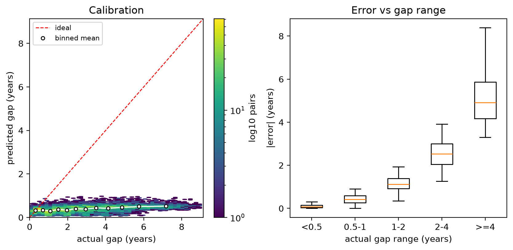
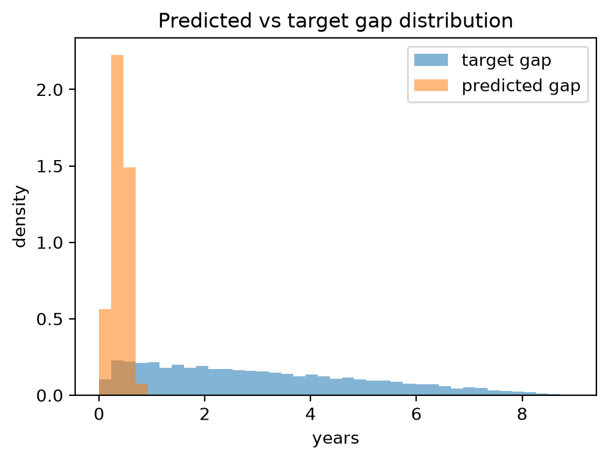
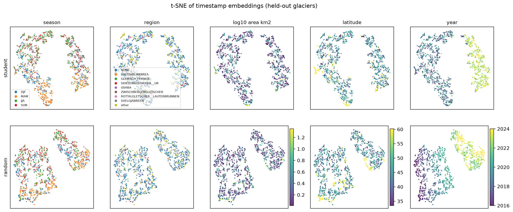
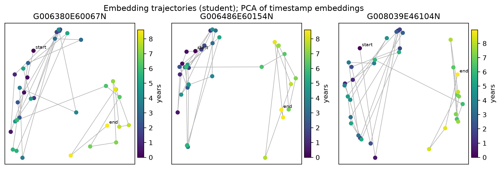
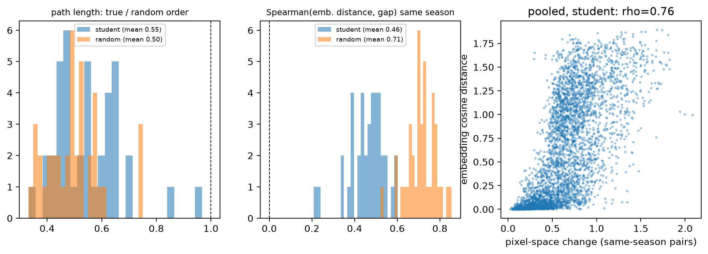
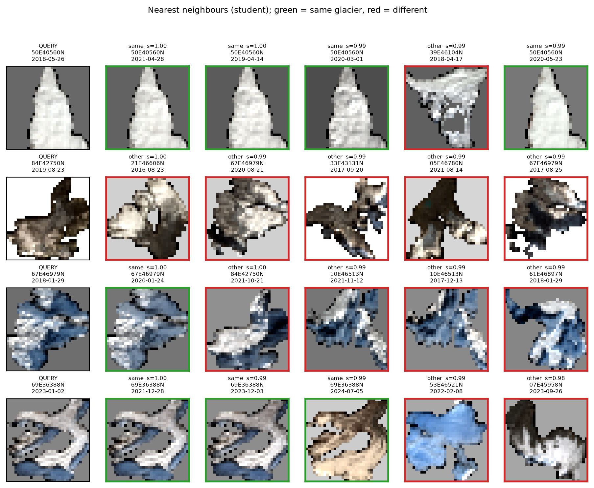
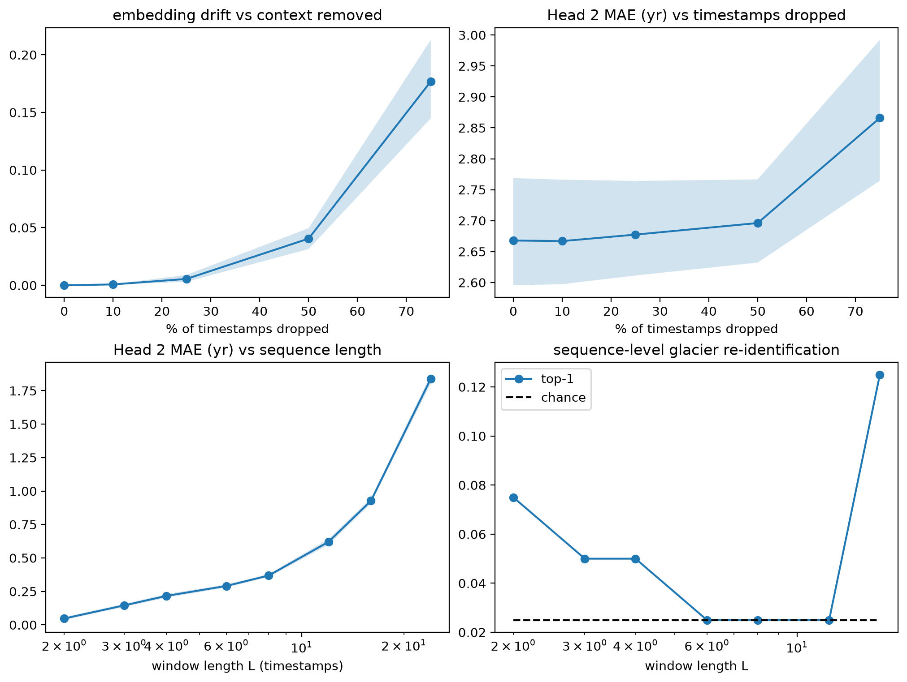
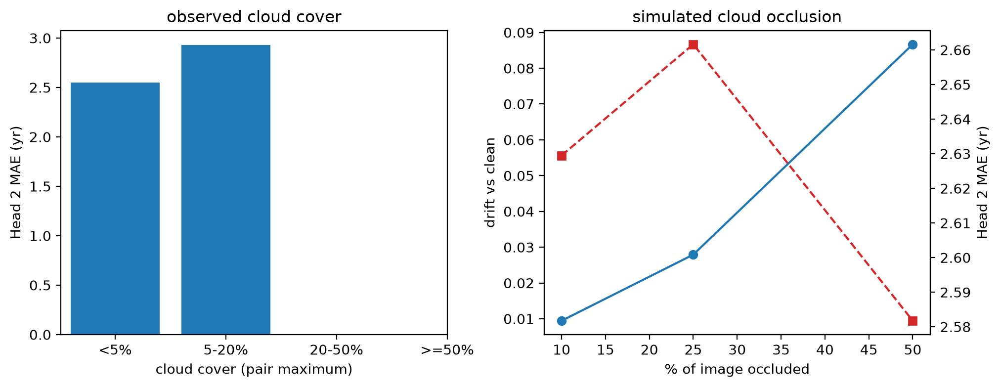

# Evaluation report - `output__step6720__20261109_103531__full`

- checkpoint: `src\output\ckpt_latest.pt` (step 6720, epoch 19)
- backbone evaluated: `student` | split: `test` | glaciers: 40 | timestamps: 1440
- config + seed + git state: see `run_manifest.json`
- every number below is also in `summary.json`; per-test details are in the sub-folders

## Test 1 - Head 2 (temporal distance)

Held-out glaciers: **40**, pairs: **15420**. Predictions use the **student** backbone + trained Head 2 (the path it was trained on). Errors in years; CIs resample glaciers.

**MAE 2.638 yr** (95% CI 2.599-2.679), RMSE 3.297 yr, Spearman 0.488.

### Per gap range
| gap_range_yr | n_pairs | mae_yr | bias_yr |
|---|---|---|---|
| <0.5 | 1313 | 0.1046 | 0.0180 |
| 0.5-1 | 1649 | 0.4352 | -0.4347 |
| 1-2 | 2971 | 1.1528 | -1.1528 |
| 2-4 | 4735 | 2.5444 | -2.5444 |
| >=4 | 4752 | 5.1253 | -5.1253 |

### Head 2 vs controls (head2_archi.md section 8)
| predictor | features | n_pairs | MAE_yr | MAE_95CI | RMSE_yr | Spearman |
|---|---|---|---|---|---|---|
| Head 2 (trained, student) | post-TET timestamp_out | 15420 | 2.6383 | [2.599, 2.679] | 3.2974 | 0.4884 |
| metadata: train-mean gap | metadata only (no images, no true gap) | 15420 | 1.7278 | [1.709, 1.748] | 2.0548 | nan |
| metadata: train-median gap | metadata only (no images, no true gap) | 15420 | 1.6989 | [1.675, 1.723] | 2.0725 | nan |
| metadata: linear(index diff, length, season diff) | metadata only (no images, no true gap) | 15420 | 0.0868 | [0.085, 0.088] | 0.1061 | 0.9983 |
| metadata: boosted trees(index diff, length, season diff) | metadata only (no images, no true gap) | 15420 | 0.0867 | [0.085, 0.088] | 0.1060 | 0.9983 |
| ridge probe [student] timestamp_out | post-TET (dates visible to TET) | 15420 | 1.3462 | [1.302, 1.388] | 1.7112 | 0.5730 |
| ridge probe [student] visual_pool | pre-TET appearance only | 15420 | 1.4259 | [1.396, 1.457] | 1.7993 | 0.5296 |
| ridge probe [random] timestamp_out | post-TET (dates visible to TET) | 15420 | 0.2237 | [0.213, 0.235] | 0.3051 | 0.9924 |
| ridge probe [random] visual_pool | pre-TET appearance only | 15420 | 1.4599 | [1.425, 1.494] | 1.8455 | 0.4819 |

Pair-order invariance (Experiment G): max |pred(i,j) - pred(j,i)| = 2.98e-08 (should be ~0).

**How to read this.** Head 2 only shows learned *visual* temporal distance if it beats the metadata-only rows (which see index difference / length / season, never images) AND the pre-TET appearance probe is clearly better than the same probe on random weights. If the metadata rows win, the pair construction is making the task trivially easy; if the post-TET probe is strong but the pre-TET one is weak, the score comes mainly from the explicit date encoding in the TET. Either outcome is reportable; neither supports a claim that Head 2 measures glacier change.

## Test 2 - Embedding analysis

1325 usable held-out timestamps from 40 glaciers; `student` backbone vs an untrained `random` baseline of the same architecture.

### Embedding health (collapse check)
| model | variance | effective_rank | mean_pairwise_cos | dim |
|---|---|---|---|---|
| student | 0.3723 | 22.4057 | 0.1967 | 768 |
| random | 0.2199 | 50.7889 | 0.7675 | 768 |

### Share of variance explained by each factor (eta-squared)
Rows marked `| within glacier` first subtract each glacier's mean embedding, so they show what the embedding encodes *about change over time* rather than which glacier it is.
| model | glacier identity | season | year | season | within glacier | year | within glacier |
|---|---|---|---|---|---|
| student | 0.1010 | 0.1883 | 0.4394 | 0.2115 | 0.4829 |
| random | 0.1784 | 0.1152 | 0.4326 | 0.1422 | 0.5212 |

### Linear probes (5-fold CV, whole glaciers held out)
| model | target | acc | balanced_acc | majority_chance | classes | n |
|---|---|---|---|---|---|---|
| student | season (4) | 0.5751 | 0.5778 | 0.2611 | 4 | 1325 |
| student | geographic cluster (2) | 0.7132 | 0.6484 | 0.6830 | 2 | 1325 |
| student | glacier size (area terciles) | 0.5117 | 0.5105 | 0.3404 | 3 | 1325 |
| student | latitude (terciles) | 0.4974 | 0.4885 | 0.3728 | 3 | 1325 |
| student | year | 0.6317 | 0.6312 | 0.1177 | 9 | 1325 |
| random | season (4) | 0.9970 | 0.9970 | 0.2611 | 4 | 1325 |
| random | geographic cluster (2) | 0.9623 | 0.9564 | 0.6830 | 2 | 1325 |
| random | glacier size (area terciles) | 0.3291 | 0.3259 | 0.3404 | 3 | 1325 |
| random | latitude (terciles) | 0.7147 | 0.7111 | 0.3728 | 3 | 1325 |
| random | year | 0.9789 | 0.9790 | 0.1177 | 9 | 1325 |

Geographic clusters are k-means groups of glacier centroids 49N,9E (n=27), 40N,60E (n=13). The manifest's `region` field holds glacier names rather than regions, so it cannot be probed.

A probe only supports 'the representation organises by X' when it clearly beats both `majority_chance` and the untrained baseline. Region/latitude/size accuracy can reflect glacier identity leaking through spectral appearance, since glaciers in one region look alike.

## Test 3 - Temporal trajectories

40 held-out glaciers with >= 4 usable timestamps; means over glaciers with bootstrap 95% CIs (resampling glaciers).

| model | n_glaciers | path_ratio | path_ratio_95CI | spearman_gap_all | spearman_gap_all_95CI | spearman_gap_same_season | spearman_gap_same_season_95CI | spearman_pixel_same_season | spearman_pixel_same_season_95CI | partial_pixel_given_gap | partial_pixel_given_gap_95CI | seasonal_over_annual | seasonal_over_annual_95CI |
|---|---|---|---|---|---|---|---|---|---|---|---|---|---|
| student | 40 | 0.5521 | [0.516, 0.591] | 0.4315 | [0.395, 0.470] | 0.4593 | [0.433, 0.484] | 0.7726 | [0.750, 0.793] | 0.7369 | [0.711, 0.761] | 1.6646 | [1.483, 1.854] |
| random | 40 | 0.4980 | [0.467, 0.529] | 0.6449 | [0.619, 0.671] | 0.7142 | [0.694, 0.734] | 0.7789 | [0.763, 0.794] | 0.8100 | [0.787, 0.831] | 1.5357 | [1.410, 1.665] |

- `path_ratio` < 1: the true chronological order is smoother than random order.
- `spearman_gap_*`: does embedding distance grow with elapsed time (all pairs / same-season pairs only)?
- `spearman_pixel_same_season` and `partial_pixel_given_gap`: does embedding distance track pixel-space change between same-season dates, and does it still do so once elapsed time is regressed out?
- `seasonal_over_annual` > 1: seasons differ more than the same season does year-on-year, i.e. the seasonal cycle dominates the embedding.

Mean pixel-change-vs-gap (same season) is 0.34: if this is near zero the pixel proxy mostly measures noise, and the embedding-vs-pixel correlations should be read accordingly.

**Caveat.** Pixel change is a proxy, not a retreat measurement. A positive correlation means the embedding moves when the scene looks different; it does not show that it encodes glacier retreat specifically.

## Test 4 - Retrieval

1325 usable held-out timestamps from 40 glaciers; every timestamp is a query against all others.

### Task A - glacier-identity retrieval (all test timestamps as the pool)
| representation | P@1 | P@5 | mAP | chance_P@1 | n_queries |
|---|---|---|---|---|---|
| student | 0.5336 | 0.3048 | 0.0843 | 0.0249 | 1325 |
| random | 0.2845 | 0.1701 | 0.0640 | 0.0249 | 1325 |
| raw pixels (32x32) | 0.9864 | 0.9315 | 0.4144 | 0.0249 | 1325 |

### Task B - similar state within a glacier (candidates = same glacier only)
| representation | top1_same_season | chance_same_season | hit@1_same_season_adjacent_year | chance_adjacent_year | median_top1_time_offset_yr | mean_candidate_time_offset_yr | n_queries |
|---|---|---|---|---|---|---|---|
| student | 0.4951 | 0.2284 | 0.2198 | 0.0525 | 1.5880 | 3.0239 | 1325 |
| random | 0.3019 | 0.2284 | 0.2864 | 0.0525 | 0.6160 | 3.0239 | 1325 |
| raw pixels (32x32) | 0.6687 | 0.2284 | 0.2986 | 0.0525 | 1.7659 | 3.0239 | 1325 |

Read each row against its chance column. Raw pixels are a legitimate baseline: if they match or beat the trained model on a task, that task does not demonstrate the benefit of pretraining. Identity retrieval measures appearance, so it is not evidence about temporal reasoning; Task B is the more relevant one.

## Test 5 - Robustness

Embedding drift uses the `student` backbone; Head 2 error uses the student path it was trained on. Means over glaciers with bootstrap 95% CIs.

### A. Missing observations (random drop, 3 repeats per glacier)
| condition | n_glaciers | drift | drift_95CI | seq_drift | seq_drift_95CI | mae | mae_95CI |
|---|---|---|---|---|---|---|---|
| dropped 0% (full) | 40 | 0.0000 | [0.000, 0.000] | 0.0000 | [0.000, 0.000] | 2.6679 | [2.596, 2.769] |
| dropped 10% | 40 | 0.0007 | [0.001, 0.001] | 0.0043 | [0.003, 0.007] | 2.6669 | [2.597, 2.766] |
| dropped 25% | 40 | 0.0055 | [0.003, 0.009] | 0.0294 | [0.017, 0.047] | 2.6774 | [2.611, 2.764] |
| dropped 50% | 40 | 0.0405 | [0.031, 0.050] | 0.2018 | [0.156, 0.246] | 2.6961 | [2.632, 2.767] |
| dropped 75% | 40 | 0.1768 | [0.145, 0.213] | 0.5793 | [0.518, 0.637] | 2.8660 | [2.765, 2.992] |

### B. Short sequences (first / last L timestamps)
| condition | n_glaciers | drift | drift_95CI | seq_drift | seq_drift_95CI | mae | mae_95CI |
|---|---|---|---|---|---|---|---|
| L=2 | 40 | 0.3449 | [0.316, 0.375] | 0.5452 | [0.494, 0.602] | 0.0473 | [0.036, 0.058] |
| L=3 | 40 | 0.2381 | [0.216, 0.260] | 0.3446 | [0.295, 0.405] | 0.1453 | [0.133, 0.156] |
| L=4 | 40 | 0.2524 | [0.232, 0.273] | 0.3200 | [0.277, 0.374] | 0.2163 | [0.204, 0.230] |
| L=6 | 40 | 0.2854 | [0.269, 0.303] | 0.3166 | [0.275, 0.370] | 0.2906 | [0.279, 0.302] |
| L=8 | 40 | 0.2938 | [0.280, 0.310] | 0.3182 | [0.279, 0.369] | 0.3687 | [0.357, 0.379] |
| L=12 | 40 | 0.2619 | [0.249, 0.275] | 0.3105 | [0.272, 0.358] | 0.6204 | [0.599, 0.642] |
| L=16 | 40 | 0.1106 | [0.103, 0.119] | 0.2173 | [0.169, 0.277] | 0.9270 | [0.908, 0.945] |
| L=24 | 40 | 0.2853 | [0.248, 0.324] | 0.8611 | [0.828, 0.893] | 1.8390 | [1.804, 1.870] |

Sequence-level re-identification between two non-overlapping windows of one glacier:
| window_length | n_glaciers | top1_reidentification | chance |
|---|---|---|---|
| 2 | 40 | 0.0750 | 0.0250 |
| 3 | 40 | 0.0500 | 0.0250 |
| 4 | 40 | 0.0500 | 0.0250 |
| 6 | 40 | 0.0250 | 0.0250 |
| 8 | 40 | 0.0250 | 0.0250 |
| 12 | 40 | 0.0250 | 0.0250 |
| 16 | 40 | 0.1250 | 0.0250 |

### C. Observed cloud cover
| cloud_pct_bin | n_timestamps | mean_dist_to_glacier_centroid | head2_MAE_yr_(pair max cloud) | n_pairs |
|---|---|---|---|---|
| <5% | 1192 | 0.5042 | 2.5518 | 9429 |
| 5-20% | 133 | 0.3915 | 2.9297 | 2191 |
| 20-50% | 0 | nan | nan | 0 |
| >=50% | 0 | nan | nan | 0 |

### D. Simulated cloud occlusion
| condition | n_glaciers | drift | drift_95CI | usable_fraction | usable_fraction_95CI | mae | mae_95CI |
|---|---|---|---|---|---|---|---|
| 10% of each image occluded | 5 | 0.0095 | [0.008, 0.011] | 0.9222 | [0.861, 0.983] | 2.6295 | [2.543, 2.694] |
| 25% of each image occluded | 5 | 0.0279 | [0.024, 0.032] | 0.9000 | [0.817, 0.967] | 2.6616 | [2.589, 2.724] |
| 50% of each image occluded | 5 | 0.0867 | [0.067, 0.107] | 0.7389 | [0.606, 0.861] | 2.5818 | [2.330, 2.800] |

**How to read this.** Drift measures how much context matters, not whether the output is wrong; the task-facing numbers are Head 2 MAE and re-identification. A flat Head 2 MAE as timestamps are removed supports the variable-length claim; a sharp rise at small L or high drop rates shows where the model needs context. The observed-cloud bins confound cloud with season (winter scenes are cloudier), so prefer the simulated occlusion for a controlled statement.

